# 🍌 BananaHub: Всё о бананах и весёлые банановые забавы

> **«Весёлые забавы в жёлто-белых тонах»** — интерактивный командный веб-проект с автоматическим CI/CD деплоем на GitHub Pages.

Добро пожаловать в официальный репозиторий **BananaHub**! Этот проект — результат командной работы по созданию яркого, анимированного и отзывчивого статического сайта. Проект сочетает в себе познавательный контент, интерактивные игры на чистом JavaScript и автоматизированную инфраструктуру непрерывного деплоя (CI/CD).

---

## 🔗 Быстрые ссылки проекта

* 🌐 [**Перейти на живой сайт BananaHub (Live Demo)**](https://Belka9823.github.io/teamwork_bananchiki/)
* 🚀 [**История деплоев (Deployments)**](https://github.com/Belka9823/teamwork_bananchiki/deployments)
* ⚙️ [**Настройки окружений (Environments)**](https://github.com/Belka9823/teamwork_bananchiki/settings/environments)

---

## 👥 Команда проекта и распределение ролей

Разработка проекта велась в тесном сотрудничестве с четким разделением обязанностей. Вклад каждого участника зафиксирован в истории коммитов репозитория:

| Аватар | Роль в проекте | Участник | Ответственность и выполненный объем работ |
| :---: | :--- | :--- | :--- |
| 👑 | **Team Lead & Coordinator** | Белек Абдиллатов | Создание и настройка репозитория, управление доступами (Collaborators), координация команды, финальный ревью кода и написание документации `README.md`. |
| 🛠️ | **DevOps Engineer** | Даниил Савальский | Разработка и настройка CI/CD инфраструктуры через GitHub Actions (`deploy.yml`), настройка Environments и контроля статусов деплоя. |
| 🎨 | **Frontend Developer #1** | Мария Винокурова | Разработка визуальной концепции, верстка страниц **«Главная»**, **«Факты»** и **«Отзывы»**, настройка баз CSS-стилей. |
| 🎮 | **Frontend Developer #2** | Ольга Клюкина | Разработка JavaScript-логики игровой зоны **«Игры»**, реализация интерактивных элементов на страницах **«Викторина»** (FAQ) и **«События»**. |

---

## 📄 Путеводитель по страницам сайта

Сайт содержит **6 полноценных разделов**, доступных через сквозное верхнее меню навигации:

1. 🏠 **`index.html` — Главная страница**  
   Приветственная страница сайта. Содержит яркий заголовок, краткое введение в банановую тематику, анонсы основных разделов и быстрые призывы к действию (CTA).

2. 🎮 **`games.html` — Банановые игры**  
   Интерактивный игровой центр, включающий три мини-игры на чистом JavaScript.

3. 📖 **`facts.html` — Интересные факты**  
   Познавательный раздел с карточками фактов о происхождении бананов, их питательных свойствах и необычных вариантах использования.

4. 💬 **`reviews.html` — Банановые отзывы**  
   Страница обратной связи с опубликованными отзывами пользователей и интерактивной формой для отправки новых комментариев.

5. ❓ **`questions.html` — Викторина о бананах**  
   Интерактивный список популярных вопросов с раскрывающимися блоками (аккордеон) для удобного чтения.

6. 🎉 **`ivents.html` — События**  
   Календарь актуальных событий, банановых фестивалей и новостей сообщества.

---

## 🎨 Дизайн и UI/UX концепция

Дизайн сайта выполнен в приятных **жёлто-белых тонах**, создающих легкую и позитивную атмосферу:
* **Цветовая палитра:** Мягкий кремово-жёлтый фон (`#FFFBE6`), яркие желтые акценты (`#FFE58F`, `#FFD666`) и контрастный тёмно-коричневый текст для оптимальной читаемости.
* **Интерфейс:** Карточная система с мягкими округлыми углами (`border-radius`), объёмными кнопками и выразительными иконками.
* **Анимации:** Плавные переходы (`transitions`), эффекты наведения на карточки и кнопки (`hover`), а также динамический микро-интерактив при кликах.

---

## 🏗️ Структура и архитектура репозитория

```mermaid
graph TD
    Root[📁 Корень репозитория] --> Assets[📁 assets/]
    Root --> Readme[📝 README.md — Документация]
    
    %% Главная и глобальные стили
    Root --> Index[📄 index.html — Главная]
    Root --> Style[🎨 style.css — Глобальные стили]
    Root --> Script[⚡ script.js — Глобальные скрипты]
    
    %% Раздел Игры
    Root --> GamesHtml[📄 games.html — Раздел «Игры»]
    Root --> GamesCss[🎨 games.css — Стили игр]
    Root --> GamesJs[⚡ games.js — Логика игр]
    
    %% Раздел Факты и Отзывы
    Root --> FactsHtml[📄 facts.html — Раздел «Факты»]
    Root --> ReviewsHtml[📄 reviews.html — Раздел «Отзывы»]
    
    %% Раздел Вопросы (FAQ)
    Root --> QuestionsHtml[📄 questions.html — Раздел «Вопросы»]
    Root --> QuestionsCss[🎨 questions.css — Стили вопросов]
    Root --> QuestionsJs[⚡ questions.js — Скрипты вопросов]
    
    %% Раздел События
    Root --> IventsHtml[📄 ivents.html — Раздел «События»]
    Root --> IventsCss[🎨 ivents.css — Стили событий]
    Root --> IventsJs[⚡ ivents.js — Скрипты событий]


```



---

## ⚙️ Настройка CI/CD и автоматический деплой

Проект использует автоматизированный процесс сборки и публикации через **GitHub Actions**:

### Конфигурация Workflow (`.github/workflows/deploy.yml`)
Каждый `push` в главную ветку `main` автоматически запускает процесс деплоя:
1. **Checkout кода:** Выгрузка актуальной версии исходников.
2. **Setup Pages:** Инициализация окружения GitHub Pages.
3. **Upload Artifact:** Упаковка статических файлов сайта (HTML/CSS/JS/изображения).
4. **Deploy to GitHub Pages:** Автоматическая публикация сайта в окружении `github-pages`.


---

## 💻 Локальный запуск и разработка

Чтобы запустить проект на локальном компьютере:

1. **Склонируйте репозиторий:**
   ```bash
   git clone https://github.com/Belka9823/teamwork_bananchiki.git
   ```
2. **Перейдите в директорию проекта:**
   ```bash
   cd teamwork_bananchiki
   ```
3. **Запустите проект:**
   Откройте файл `index.html` в любом современном браузере или используйте плагин **Live Server** для VS Code.


---

<p align="center">
  <b>BananaHub Project © 2026</b> — Разработано с душой и банановым настроением 🍌✨
</p>